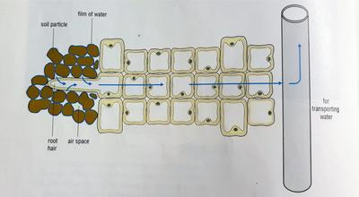

## Transport of water in plants

### Root hair cells

* **Root hair cells** - tiny hair like projections in the roots that increase the surface area of absorption.
* They grow between soil particles and take in large quantities of water.
* Water in the soil is drawn in to replace the water that has evaporated from the leaves.
* Plants do not require energy to take in water.
* Mineral salts are dissolved in soil water, and root cells use energy made from respiration to take in the salts.
* Roots get oxygen to respire from the air spaces between soil particles.

### Xylem and Vascular bundles

* Cells in the plant form tubes to transport water. They form columns in the plant and the cells die, causing the walls between them to break down - forming tubes.
* Each water conducting tube is called a **xylem** (pronounced *zylem*) vessel.
* A group of vessels form a **xylem tissue**, which make up a part of structures called **vascular bundles.**
* They run through the plant from the root to the leaf where they form leaf veins.

### Roots and water

* The root has the ability to push water up the plant only a little way.
* Water reaches all parts of the stem due to the transpiration stream.