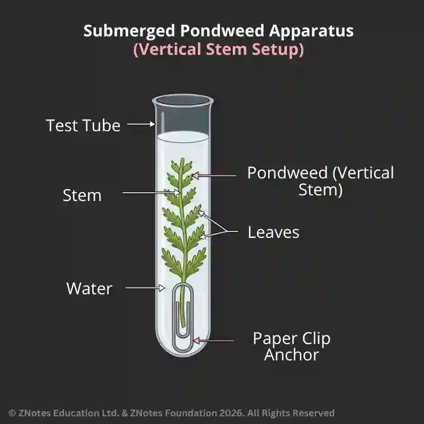

## Plant Investigations

### **Testing for starch**

Plant cells are found to contain colourless grains of starch under the microscope. This is quite difficult to see, so dilute solution of iodine is added. This makes the starch turn blue-black.

1. Place a leaf in boiling water for few minutes. This removes the cell wall and allows the starch-identifying agent iodine to enter the cells.
2. Now put the leaf in a test-tube of ethanol and hold it above a warm water bath. Ethanol is volatile and cannot be directly heated. It removes the green-pigment chlorophyll and allows us to see the colour change easily.
3. Use tweezers to place the leaf on a petri-dish.
4. Add few drops of **iodine** solution.
5. The leaf turns **blue-black** in the presence of starch.

### **De-starching a plant**

In an experiment where you have to check if starch has been made by the plant, you have to start out with a plant that does not contain starch.

1. A green plant with leaves containing starch must be left in darkness for 2-3 days. Cutting off access to light prevents photosynthesis, and glucose (simpler form of starch) isn’t produced.
2. Test the leaves to make sure they’re starch-free.
3. This is a de-starched plant.

### **Effect of $CO_2$ on starch production**

**Soda Lime**- substance that absorbs Carbon dioxide and takes it out of the air.

**Sodium hydrogencarbonate** solution - liquid that releases Carbon dioxide into the air.

1. Set up two identical destarched plants and cover them with transparent plastic bags, sealing them around the pot using elastic bands.
2. Before sealing them, place a small dish of soda lime inside pot A and a dish of sodium hydrogencarbonate inside B.
3. Leave both plants in daylight for a few hours.
4. Test a leaf from plant A and a leaf from B for starch.
5. **Conclusion** - leaf from plant with soda lime (absorbs $CO_2$) didn’t contain starch, this suggests that $CO_2$ is necessary for starch production.

### Effect of light on starch production

1. Take a de-starched plant and cover one leaf with aluminium foil, and another leaf in transparent plastic.
2. Plant is left for 4 hours in a sunny place.
3. Covers are removed, leaves are tested for presence of starch.
4. Leaf covered in aluminium foil shows zero starch production This shows that light is necessary for photosynthesis.

### Effect of chlorophyll on starch production

1. A variegated plant is required for this - plant with green and white leaves.
2. Plant is de-starched and placed in light for 4 hours.
3. When the leaf is removed and tested for starch, green parts of the leaf (that contains chlorophyll) turn blue-black in iodine, but the white parts don’t.
4. This shows that chlorophyll is needed for starch production.

### **Investigating oxygen production in plants**

Water plants can be used to investigate the gases produced as they escape from the leaf surface in bubbles that are easily seen and collected.

1. Set up two samples of pondweed as shown in the figure below.

2. Place one sample in a sunny spot, and the other in the dark.

3. After a week, examine the gas collected in the two test tubes.

4. The plant under sunlight would have produced gas, and the plant in the dark would have not.

5. Test the gas using a glowing splint. The splint should re-ignite, showing that the gas contained more oxygen than normal air.

   