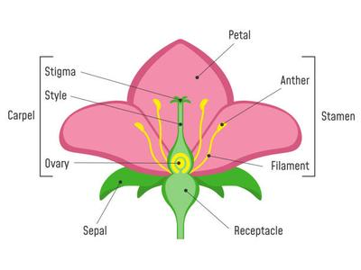

# Reproduction in Flowering Plants

## Insect pollinated flowers

### Parts of the flower

 

| Insect Pollinated Flower | Definition |
|----|----|
| Petals | Large and colourful part of the flower, attracts insects |
| Corolla | Male part of the flower present inside corolla |
| Stamens | Male part of the flower present inside corolla |
| Filament | Bottom part of the stamen that forms the ‘stalk’ |
| Anther | Top part of the stamen which produces pollen |
| Carpel | Female part of the flower present inside the ring of stamens |
| Stigma | Top part of the carpel, pollen receiving surface |
| Ovary | Bottom part of the carpel, contains ovules |
| Style | Middle part of the carpel, connects stigma and ovary |
| Sepal | Small and tough leaf-like structure. Protects the flower when it’s a bud |
| Calyx | Ring formed by sepals |
| Nectaries | Produces sweet liquid, at the base of the petals. |

