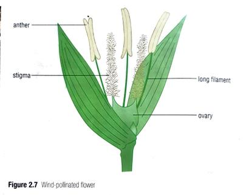
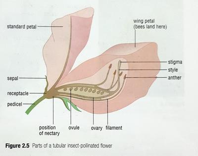

## Wind Pollinated Flowers

|Part of Plant|Wind Pollinated|Insect Pollinated|
|:---|:---|:---|
|Flower|Small flowers|Larger flowers|
|Petals|Dull or green|Colourful|
|Nectar|Absent|Present|
|Scent|Absent|Present, unique to each species|
|Filaments|Long, hangs outside in the wind|Short, present inside the flower|
|Pollen|Small, light - easily carried by wind|Large, spiky and sticky to stick to bodies of insects|
