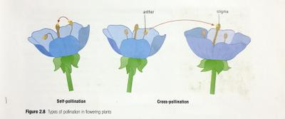

## Pollination

### Pollen grains

* In plants the male gametes are produced in the **anthers** where each one is called a **pollen** **grain.**
* The female gamete called the egg cell is in the **ovule.**
* When the pollen grains are fully formed, the anther spits open to release them.
* **Self-pollination** occurs when the pollen is transferred from an anther to a stigma of the same flower or another flower on the same plant.
* **Cross-pollination** occurs when the pollen goes from an anther to a stigma of a flower on another plant of the same species.
* Most plants have flowers with both male and female reproductive organs.
* They can avoid self-pollination in two ways:

1. Releasing pollen from the anthers before the stigma is ready to receive it
2. Stigmas are ready to receive pollen from other plants of the same species before it’s own anthers are ready to release the pollen.

 

### Bees and flowers

* Scent from nectar-producing flowers travel through the air, stimulating the receptor cells of the bee.
* As the bee flies closer, it uses its eyes to find the flower- which are sensitive to **ultraviolet** light. This makes some of the pale markings on the flower appear more distinctly to them, helping the bee identify the flower.
* The markings running down the petal of the flower are known as *honey guides* and direct the bee to the nectar.
* After landing on the flower, the bee probes the nectary with it’s mouth.
* While getting to the nectar, it brushes past the anthers, causing pollen to collect on the hairs of its back.
* After collecting nectar, the bee flies onto the next flower to feed again. Some of the pollen on its back passes onto the stigma of the second flower.
* Stiff hairs on the bee’s legs collect the pollen from the bee’s back and stored on these hairs on the back legs called ‘*pollen baskets’.*
* Nectar is changed to honey with the help of enzymes and other substances.
* Bees regurgitate the honey and passes it on to other bees working in the hive. Pollen is removed from the baskets and stored as well.
* The bee indicates the source of the nectar to the other bees in the hive by performing a dance on the honeycomb- by moving in circles, moving its abdomen, moving up and down.
* From this, the other bees can tell the distance, direction and amount of nectar available, and can search for it.

