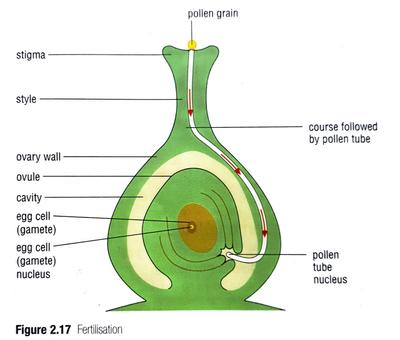

## Fertilisation

* Pollen grain breaks open and form a **pollen tube** after it reaches the surface of a stigma.
* Male gamete cell in the pollen grain moves down the tube, all the way into the ovary.
* Ovary contains **ovules** (female gamete).
* When the tip of the pollen tube reaches an ovule, the male gamete enters the ovule, and fuses with the female gamete.
* This is called **fertilisation,** producing a cell called **zygote.**

### After fertilisation

* The zygote divides many times to produce a group of cells, forming a tiny plant.
* Structures that later become the root and shoot are developed, and a food store is created.
* The outer part of the ovule forms a tough coat. When all the changes are complete, the ovule has become a *seed.*
* Meanwhile, the petals and stamen fall way. Stigma and style wither and the ovary changes into a *fruit.*

 

