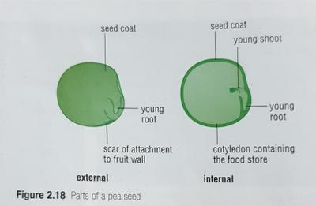

## Seed Dispersal

### Need for seed dispersal

* Plants produce many fruits. If all of them fell to the ground surrounding the plant, growing into new plants.
* There would be hundreds of plants growing too close to each other, competing heavily for minerals, soil, water and light- causing many to die
* Overcrowding is prevented by fruit and see dispersal.
* Seeds may land in unsuitable surrounding, where they fail to grow.
* But since plants produce large number of seeds, it increases the chances of few reaching optimum environments to grow.

 

### Types of seed dispersal

* Brazil nut trees in the amazon, and oak trees in the north have fruits that just fall to the ground.
* Squirrels collect the acorns and agouti open the tough coating of the Brazil nut fruit, carrying the seeds away to store.
* The animals return to the food stores to feed on them, but eventually forget about them.
* These ‘lost’ seeds may germinate, growing into big trees.
* Goose grass have fruits with **hooks** on them, allowing them to stick to the fur of passing mammals.
* The fruits are carried several kilometres before they are rubbed off/fall to the ground.
* The flesh of succulent fruits is brightly coloured and are eaten by many mammals and birds along with the small seeds.
* The seed coats are resistant to the digestion process, and the seeds remain intact in the animals’ faeces.
* Larger seeds from stone fruits are thrown away by the animal after they’ve eaten the softer parts.
* Fruits with a small mass develop long hairs which *increase air resistance* of the fruit, allowing it to be blown away.
* Dandelions have fruits that form a tuft of hair which act as a parachute, slowing down the sinking speed as the wind blows it along.
* Fruits with a larger mass that are dispersed by the wind have a part that is shaped into an **aerodynamic wing.**
* The *large surface area* of the wing catches the wind as the fruit falls from the branches, letting it be carried away from the tree in the air currents.
* Some plants such as the lupin and gorse produce fruits called pods that *dry and twist.*
* The *tension* in the twisting pod is great enough to split the pod open, shooting the seeds out.

