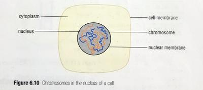
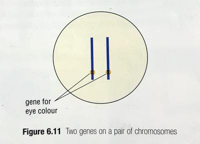
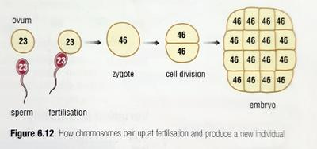

# Cells and Reproduction

Cells have a cell membrane, cytoplasm and a **nucleus.**

Examining living cells under a microscope led to the discovery that certain changes took place in the nucleus which were linked to reproduction.

Just before a cell divides, long strands of material appear in the nucleus, called **chromosomes..**

Before cell divisions, each chromosome makes a copy of itself, and it lies as two threads. During cell division, the pair of threads separate, each entering a new nuclei.

Once each cell forms, every thread becomes a chromosome.

This means that nuclei of the new cells have the same number of chromosomes as the original.

* Chromosomes in the nuclei of the new cells then seem to disappear into the nuclear material but become visible under the microscope once more when the cells are about to divide.

### Chromosomes and genes

Chromosomes are arranged in pairs in the nucleus. Humans have 46 chromosomes in their cell nuclei, in 23 pairs. Fruit flies have 8 chromosomes in 4 pairs.

* Chromosomes are considered as threads of chemical messages. Each message is called a **gene.**

  Genes provide all the information of how the cell grows, develops, and behaves and it also controls growth and development.

* Each pair of chromosome has pairs of genes that carry information for a particular **characteristic** such as eye/hair colour.

* The 23rd pair of chromosome in humans determines the gender: XX is female and XY is male.

### Chromosomes and gametes

|Species|Male gamete|Female gamete|
|:---|:---|:---|
|Animal|Sperm cell|Egg cell / Ovum|
|Plant|Pollen grain|Egg cell (in the ovule)|

* Gametes are haploid reproductive cells that fuse together in sexual reproduction to form a fertilised egg (zygote).
* Gametes contain genetic information that is passed from a parent to their offspring.
* During fertilization the nuclei of the male and female gametes join together, and a **zygote** is formed. This then grows into an individual organism.
* If gametes were produced the same way as **somatic** (ordinary) cells they would have the same number of chromosomes as body cells. This would be an issue as the zygote would have twice as many chromosomes from the parent.
* If zygotes from this generation reproduced, the new zygotes would have 4 times as many chromosomes as the parent. After a few more generations the zygotes would be packed with so many chromosomes that they would die.
* This clearly doesn’t happen as there is a special type of cell division that takes place in the reproductive organs which produces gametes with half the number of chromosomes in somatic cells.
* In this cell division, the chromosomes do not make copies of themselves but the pairs separate and move into the newly forming cells- gametes.
* So, gametes have *23 chromosomes* instead of 23 pairs (46 chromosomes).

