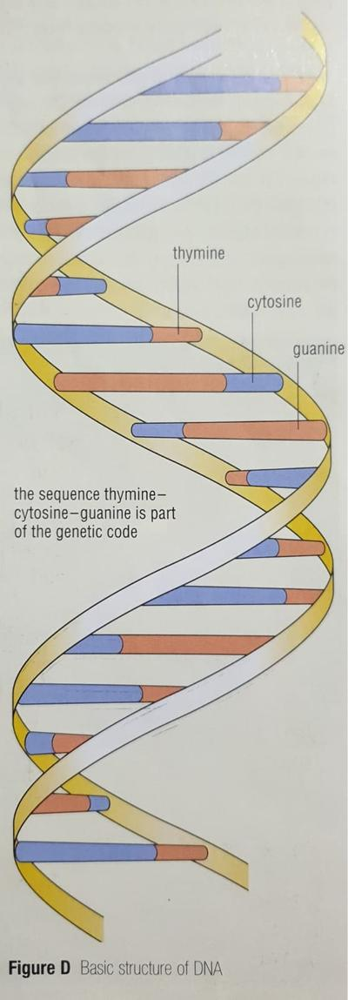

## Genes and variation

* During the formation of gametes, parts of the chromosome swap portions, leading to a mixing-up of the genes so an exact copy of the parent’s genetic code is not passed on.

* When a zygote is formed after fertilization the nucleus contains all the genes needed to make the new organism.

* The new individual develops a slightly *different combination* of features from the parents, leading to **variation** in the species.

* The difference in genetic information between individuals of the same species is known as **Genetic variation**.

### How do genes work together?

* As cells divide and form the embryo and foetus, all the genes in their nuclei are not used or switched on at once.

* When it is time for an organ to develop, the genes that control its development switch on and the cells that are produced make the organ.

* Other genes also present on the chromosomes but controlling the development of the other organs do not switch on in these cells.

Example: In the production of the windpipe and trachea the genes of some cells will switch on to make ciliated epithelial cells.

---