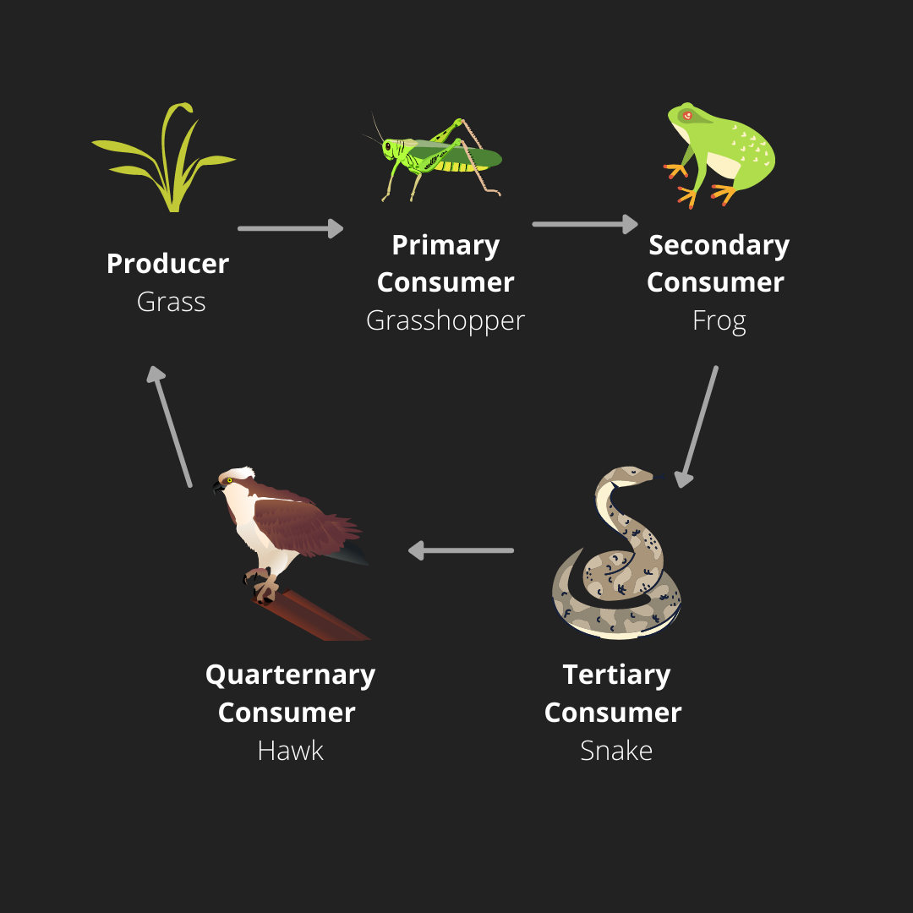

## Food chains

Food chain is the sequence of energy transfer between organisms through feeding. Food chains can combine to form food webs.

There are different types of organisms that can be found in a food chain:

* **Producers**- organisms that make their own food; plants.

* **Consumers**- organisms that eat the food.

* **Herbivores**- organisms that consume only plants.

* **Carnivores**- organisms that consume other organisms.

* **Omnivores**- organisms that consume *both* plants and other organisms.

There are different parts in a food chain:

* **Food web** - interconnected food chains in a habitat

* **Trophic levels** - positions organisms occupy in a food chain

* **Pyramids** - show number or biomass at each trophic level

* **Decomposers** - break down dead organisms and recycle nutrientsRecording plant life

The diagram below shows an example of a food chain.

The hawk eventually dies and it decomposes into the ground, adding nutrients back into the soil and thus completing the cycle