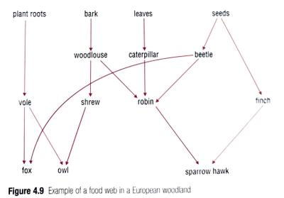

## Food chains and webs

### Energy in food chains

When eating a producer, you **cannot** take in all the energy that the plant trapped to make food.

* While the plant was growing, it used some of the energy to stay alive and to build new materials so that its cells could divide and grow.
* Animals use energy for life processes such as breathing, digesting food and moving their bodies. Some energy is lost as heat to the surroundings, due to the chemical reactions taking place inside the organs.
* This means that as energy passes along a food chain, some energy is lost from the food chain at every link.

### Food webs

Why do some animals appear in more than one food chain?

* If the trees in a habitat had a disease that made their leaves fall off, caterpillars who relied on those leaves would starve and die. 
* They won’t be available as food for robins. Thus, robins must eat more woodlice, and beetles to survive.
* Other animals that also rely on beetles will run out of food.

   

  This domino effect can wipe out entire ecosystems. Thus, each animal relies on more than one source of energy.

