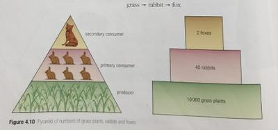
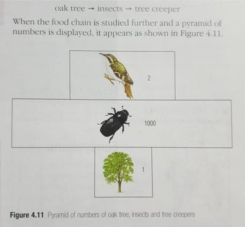

## Ecological pyramids

Ecologists study diets of animals in a habitat to work out food chains and ecological pyramids.

### Pyramid of numbers

* Number of each species in the food chain in a habitat is estimated.
* Number of plants maybe estimated using a quadrat..
* Number of small animals maybe estimated using traps, nets, and beating branches.
* Larger animals are found by counting.
* Pyramid is divided into layers, with each tier for each species in the food chain.
* Size of the tier represents the number of species in the habitat.
* Not all pyramids of numbers are widest at the base.

### Pyramid of biomass

* Amount of matter in a body is found by drying it to remove all water, and then using scales to find the mass.
* This measure is useful as it tells us how much matter is present in each species along the food chain.