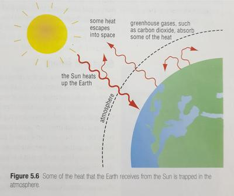

## **The ozone layer**

15 to 40 kilometres above the Earth, ultraviolet rays from the sun reacted with oxygen to produce ozone (O3O3​formed from 3 oxygen atoms).

Ozone prevents ultraviolet radiation (which is harmful to life) from reaching the Earth’s surface.

If the ozone layer hadn’t developed, life may not have evolved over the entirety of the planet, as is today.

Recent human activities have led to increasing carbon dioxide, sulphur dioxide, *chlorofluorocarbons(CFC)* percentages in the atmosphere, which destroy large portions of the ozone.

