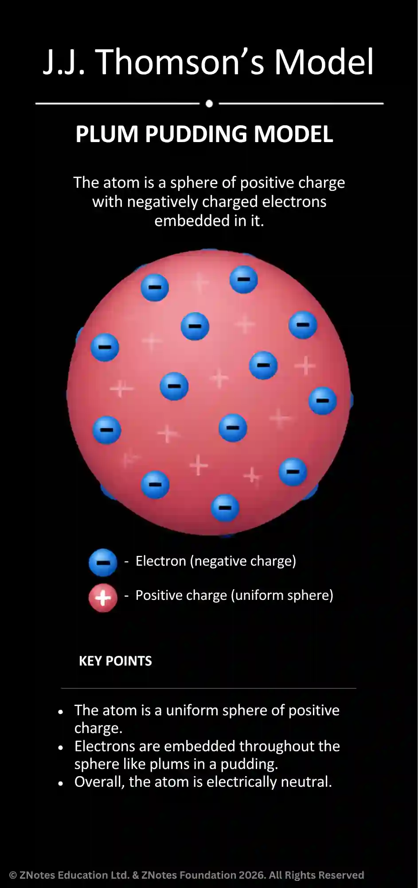
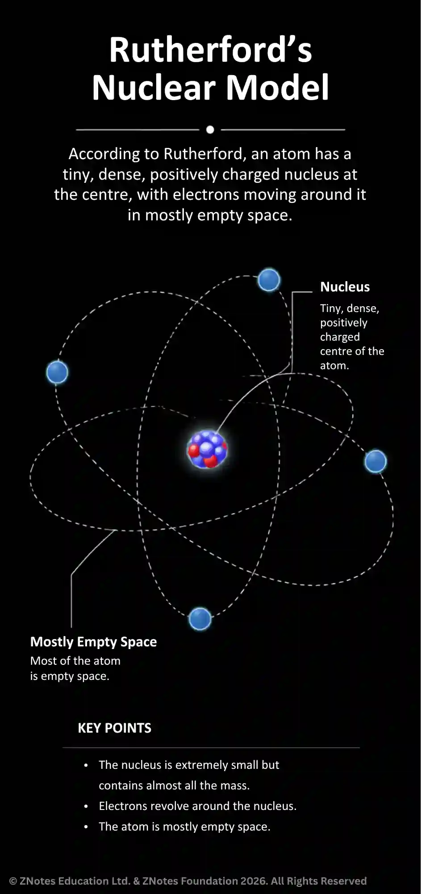
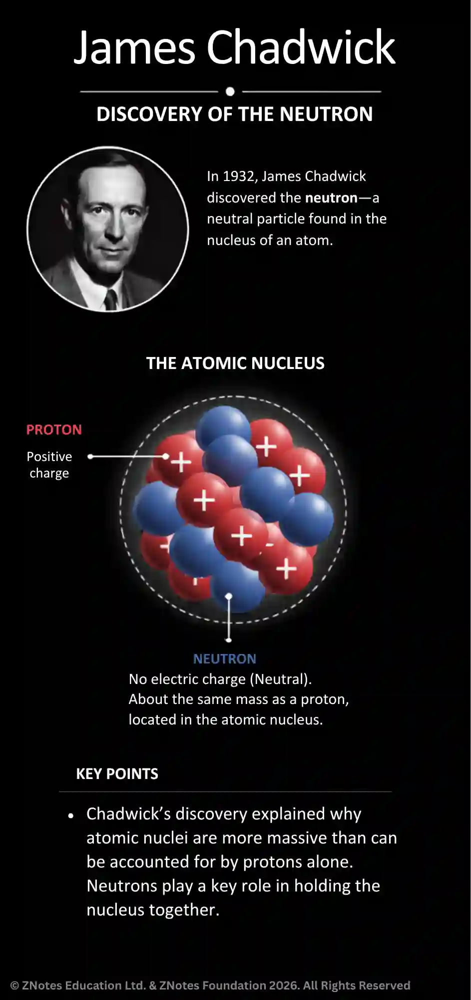
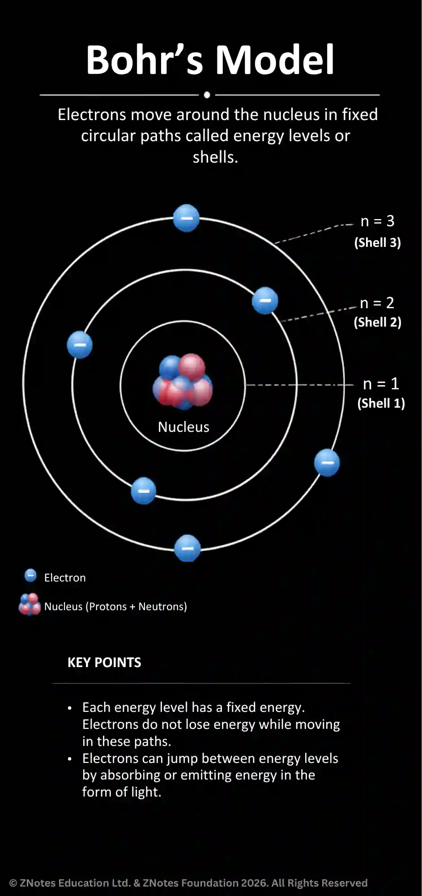

## What is an Atom?

* Atoms are the smallest part of an element that can exist;
* The word atom derives from the Ancient Greek word “atomos” (a meaning “not” and Tomos meaning “cut”)
* It means that it is incapable of being divided.

#|
||

Subatomic particle

|

Mass

|

Charge

|

Location

||
||

Proton

|

1 atomic mass unit (amu)

|

Positive charge ( \+1 )

|

Found in the nucleus

||
||

Neutron

|

1 atomic mass unit (amu)

|

Neutral charge ( 0 )

|

Found in the nucleus

||
||

Electron

|

Almost no mass at all

|

Negative charge (-1)

|

Found in orbits around the nucleus

||
|#

**Atomic Model**

J.J.Thomson’s Plum Pudding Model (1904)

* Thomson discovered the electron using a cathode ray tube, and later proposed that an atom is a uniform sphere of positive electrical charge with negative electrons scattered randomly inside it.

* His model did not possess a central nucleus and could not be used to explain the alpha particle deflections. 

Ernest Rutherford Nuclear model (1911)

* In 1905, Ernest Rutherford did an experiment to test the plum pudding model. It all started with directing a beam of **alpha particles** at a very thin gold leaf suspended in a **vacuum**.

* Conclusion:

  * Most of the alpha particles did pass straight through the foil
    * This shows that atoms is mostly in empty space.
  * A small number of alpha particles were diverted by large angles (\> 4°) as they passed through the foil
    * It shows that there is a concentration of positive charge in the atom.
  * A very small number of alpha particles came straight back off the foil
    * It shows that the positive charge and mass are concentrated in a tiny volume in the atom.

James Chadwick’s discovery of the Neutron (1932)

* Chadwick discovered the neutron when he bombarded beryllium with alpha particles and measured the radiation emitted. 

* He later proved that neutron was a neutral particle found in the nucleus, which explained why atoms were heavier than the combined weight of their electrons and protons.

Bohr’s Model (1913)

* Niels Bohr refined Rutherford’s model by suggesting that electrons travel in fixed energy levels at specific distances from the nucleus.

* It suggested that electrons can jump from one level to another be absorbing or releasing specific amounts of energy.

