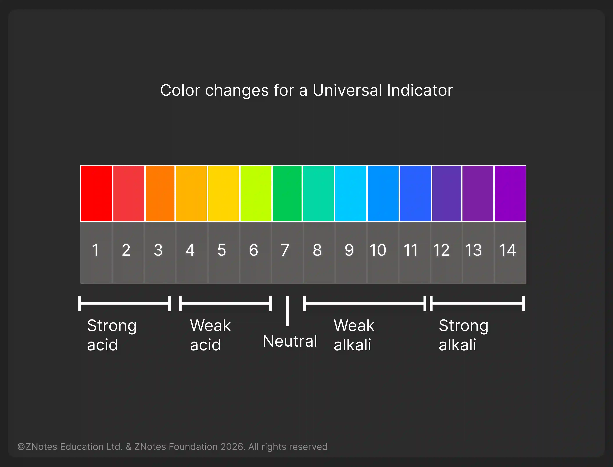

## Detecting Acids and Alkalis

### Who Invented The Indicator?

* Robert Boyle was an Irish scientist who lived over 300 years ago.
* He studied acids and alkalis and decided to try and find an easy way to identify them.
* It all started when he knew that in France workers who made silk clothes dyed them with the juices of plants and he began testing the plant juices to see if they would solve this problem.
  * When acid is added to red cabbage juice, it turns from purple to red.
  * When alkali is added, the juice turns from purple to green.
  * He also found that juices from violets turned purple with acid and greenish-yellow with an alkali.
* There are 20 indicators that scientists use. Here are some of the examples:

### Litmus (liquid or paper)

* Litmus indicator solution turns red in acidic solutions and blue in alkaline solutions. It turns purple in neutral solutions.
* Litmus solution is purple.
* Litmus paper for testing an acid is blue.
* Litmus paper for testing an alkali is red.

||Red Litmus|Blue Litmus|
|:---|:---|:---|
|Acidic Solution|Stays red|Turns red|
|Neutral Solution|Stays red|Stays blue|
|Alkaline Solution|Turns blue|Stays blue|

### **Universal Indicator (liquid or paper)**

* The universal indicator has many color changes, from red (for strongly acidic solutions) to dark purple (for strongly alkaline solutions). In the middle, neutral pH seven is indicated by green.

  