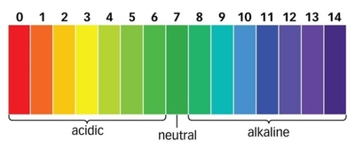

## The pH Scale

* The pH scale runs from 0-14.
* On this scale, the strongest acid is 0 and the strongest alkali is 14.
* A strong acid has a pH of 0-2, a weak acid has a pH of 3-6.
* **Neutral solutions have a pH of 7**. For example, pure water.
* A weak alkali has a pH of 8-11 and a strong alkali has a pH of 12-14.
* Each indicator changes color over part over a range of the scale.
* By combining the indicators, a solution is made that gives different colors over the whole pH range.

