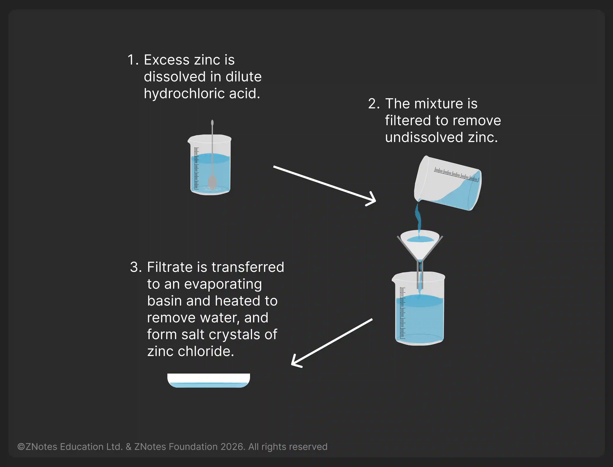

## Making Salts

Reaction with Acids

### Acids and Reactive Metal

* Acids will react with reactive metals, such as magnesium and zinc, to make salt and hydrogen.

  Acid \+ Metal → Salt \+ Hydrogen

* Example:

  * Hydrochloric acid \+ zinc → zinc chloride \+ hydrogen

    $2HCl + Zn → ZnCl₂ + H₂$

  * The hydrogen causes bubbling during the reaction

  * In general, the more reactive the metal, the faster the reaction. This is indicated by more bubbles that show up.

**Practical: Salt making**

### Acids and Metal Carbonates

* When acids react with carbonates, such as calcium carbonate (found in chalk, limestone, and marble), salt, water, and carbon dioxide are made.

  Acid \+ metal carbonate → salt \+ water \+ carbon dioxide

* Example:

  * Sulfuric acid \+ iron(II) carbonate → iron(II) sulfate \+ water \+ carbon dioxide

    $H₂SO₄ + FeCO₃ → FeSO₄ + H₂O + CO₂$

    * The carbon dioxide causes bubbling during the reaction, which is observed as fizzing. It can be detected by passing the gas through limewater, which will go cloudy.
    * Also, the reaction of metal carbonates with acids is **exothermic**. This type of reaction can be used to test unknown solutions to see if they are acidic.