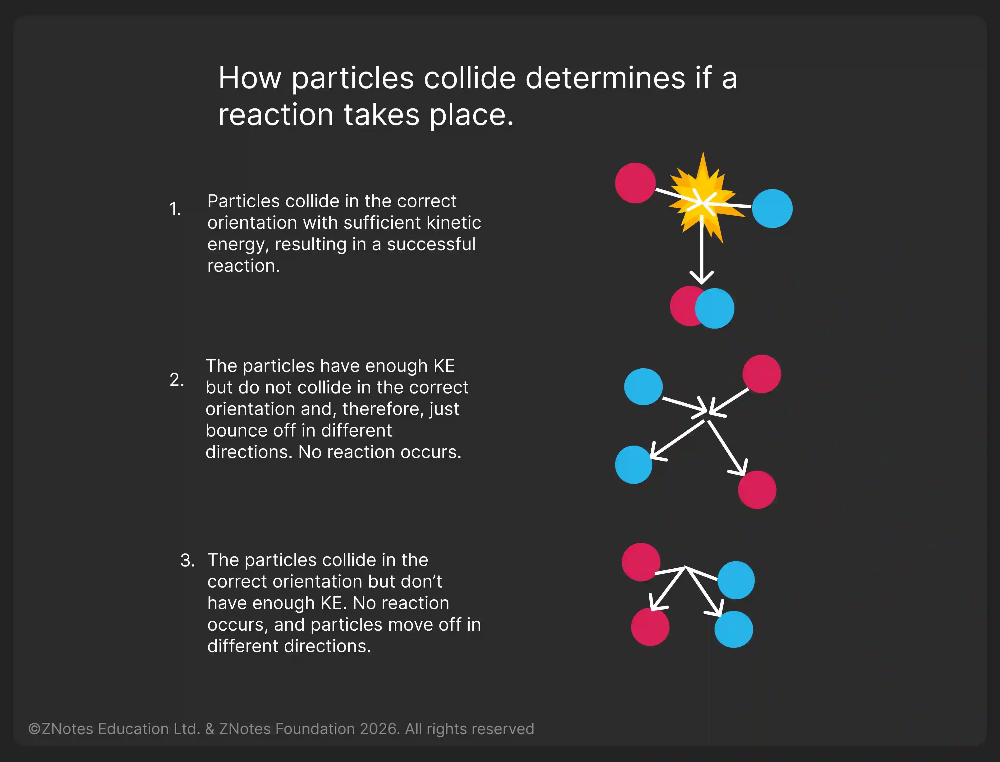

## Collision Theory

### What is the Rate of The Reaction?

* The speed of the reaction
* Reactions take place when particles collide with a certain amount of energy
* For a reaction to take place between two reactant particles, there are three conditions that are necessary
  * The two-particle **must collide with each other**
  * They **must collide in the correct orientation:** The reactive parts of each particle will come into contact with each other
  * The reactants **must collide with sufficient kinetic energy** to bring about the reaction
* The rate of reaction depends on two things:
  * The **frequency** of collision between particles
  * The **energy** with which particles collide
* If the particles collide with **less energy** **than the activation energy**, they will not react.

  

### **Factors Affecting The Rate of Reaction**

### **Temperature**

* The higher the temperature, the faster the reaction
* An increase in temperature causes a rise in the energy level of the molecules involved in the reaction, so the rate of the reaction will increase.

### Concentration

* The higher the concentration at a dissolved reactant, the faster the reaction
* Increasing the concentration of one or more reactants will increase the reaction rate. This occurs because a higher concentration of a reactant will lead to more collisions of that reactant in a specific time period.

### Particle Size

* The surface area increases when the solid is split into several pieces.
* The **smaller the pieces**, the larger the surface area, the greater the chance of reaction

### Catalyst

* A catalyst speeds up a chemical reaction, without being consumed by the reaction.
* It increases the reaction rate by lowering the activation energy (minimum amount of energy needed for the particles to react) for a reaction.