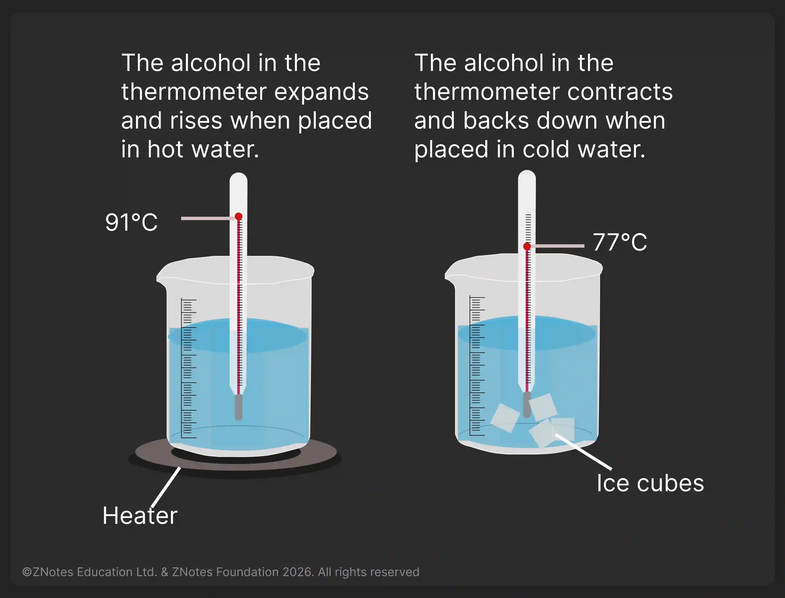

## Heat and Temperature

### Measuring Temperature

* The hotness or coldness of a substance is measured by taking its temperature.
* This temperature is measured on a scale that has 2 fixed points.
* The *Celsius scale* is the most used scale.
* Its two **fixed points** are $ 0 \degree $C (melting point of pure ice \+ freezing point of pure water) and $100 \degree $ C (boiling point of pure water).
* In between these two values, the scale is divided into 100 units or degrees.
* The thermometer compares the temperature of the substance, with the freezing and boiling point of water.
* The lowest possible temperature is $ -273 \degree $ **C** (known as **absolute zero**)

### Liquids in Thermometers

* Alcohol or Mercury are the common liquids used inside thermometers.
* If the bulb of the thermometer is placed in a *hot* substance, the liquid inside *expands* and *spreads up* inside the tube. The level it reaches depends on the hotness of the substance, and the temperature can be read in the scale.
* If the bulb is placed in a *cold* substance, the liquid inside *contracts* and *backs down* the tube. The level it settles can be read from the scale.

