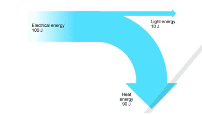

## Energy Transfer and Transform

* **As the energy is transferred it is transformed.**
* Example:
  * Reading a book with electric light: The electrical energy is being transformed into light energy.
  * To keep our body warm, some of the stored chemical energy is transformed.

### Energy Transfer Diagram

* **Energy transformation can be shown by energy diagrams. There are 3 parts to an energy transfer diagram:**
  * The first object is showing the energy input
  * The second object is showing an energy converter or transducer
  * The third object is showing the energy output
* Example:
  * Blowing up balloon: kinetic energy → ballon → strain energy
  * Taking a photograph: light energy → camera → chemical energy
  * Releasing a catapult: strain energy → catapult → kinetic energy

### Sankey Diagram

* A sankey diagram is a second kind of diagram that shows energy changes

* It features arroes of different width. The width of the arrow indicates the amount of energy it represent.

* The unit in which energy and work are measured is called the joule (J).

* Example:

  