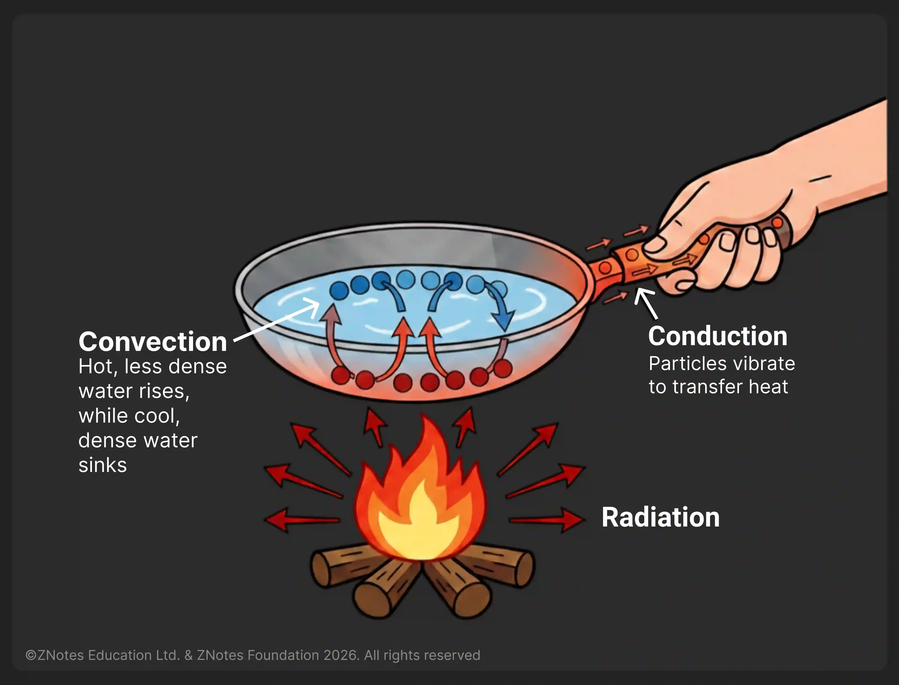

## The Difference Between Conduction, Convection, and Radiation in Heat Transfer

* Heat is the transfer of energy from a warmer object to a cooler object
* There are types of heat transfer

### Conduction

* The transfer of energy by direct contact.
  * This transfer occurs when molecules hit against each other.
* Happened due to the difference in temperature
* Conduction takes place in solids, liquids, and gases, but works best in materials that have simple molecules (example: metals).
* Heat transfer in conduction is pretty slow.

### Convection

* Convection is the movement of heat by a fluid such as water or air.
  * The fluid (liquid or gas) moves from one location to another, transferring heat along with it.
* Happened due to the difference in density.
* Heat transfer in convection is faster than conduction.
* Heat transfer occurs through intermediate objects.
  * For example, water boiling in a pot.

### Radiation

* Radiation is the transfer of heat by electromagnetic waves.

* In addition to the sun, light bulbs, irons, and toasters also transfer heat via radiation.

* Heat transfer by radiation does not need any matter to help with the transfer.

* Radiation travels at the speed of light in vacuum but in practical heat transfer contexts, convection can transfer energy faster in fluids.

* The heat transfer occurs in all objects with a temperature greater than absolute zero (0 K).

  