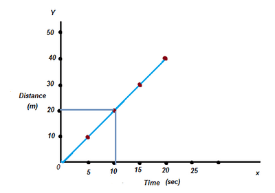
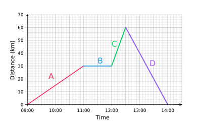

## Distance/Time Graph

* We can draw a distance/time graph to represent a journey.
* It can be used to find out distances traveled and times taken during a journey.
* **Illustration:** (if it is steady speed)
  * x-axis: time (s)
  * y-axis: distance (m)

* **How to read the graph**:

  * How far has the runner traveled after 10s? Find the 10s in the time axis and draw a line straight up from this point until it reaches the graph line, as shown. Then, draw horizontally across to the distance axis. So the answer is 20 m.

* **Illustration:** (if the speed is not constant)

  

* **How to read the graph:**

  * A= uphill
  * B= rest
  * C= uphill
  * D= downhill

|Section of journey|Time (h)|Distance (km)|
|:---|:---|:---|
|Start|0 km|0 km|
|A|2 hours|30 km|
|B|1 hour|30 km|
|C|1/2 Hour|60 km|
|D|1 1/2 hours|0 km|
