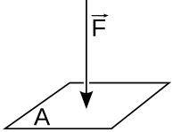

## The Relationship Between Force, Area, and Pressure

### What is Pressure?

* Pressure is defined as the force per unit area ( $ P= \frac {F} {A}$)
  * The force of an object can be worked out by multiplying mass x gravity (9.81  $ \frac {m} {s^2} $)
* The relationship:
  * If the **constant area**, the **force applied is directly proportional to the pressure.**
  * If the **force** is held constant, the **pressure is inversely proportional to the area.**
  * If the **pressure** is held constant, then the **force is directly proportional to the area.**
* SI Unit= Pa ($ \frac {N} {m^2} $). It can be also a bar, atm, kPa, etc.
* Illustration:

