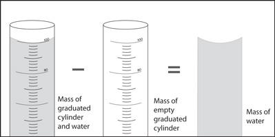

## Determine The Densities of Solid, Liquid, and Gases

### What is Density?

* A measure of how compact the mass in a substance or object is.
  * Density could be described as the number of kilograms that 1 meter cubed of a substance weighs.
* Formula:  $ P (rho) = \frac {m} {v} $
* SI Unit: $ \frac {kg} {m^3} (common) $, $ \frac {g} {cm^3} $, $ \frac {g} {mL}$ (depends on the substance)

### Calculating The Density of Solid

* Example: A rectangular prism has a mass of 42.0 grams and has dimensions of 2 cm in width, 6 cm long, and 0.5 cm in height. What is the density of this object?
  * Answer:

    1. Find the volume of rectangular prism:

       l x w x h= 2 x 6 x 0.5= 6 $ cm^3 $

    2. Put them in the formula:

       P (rho)=$ \frac {m}{v}$ = $ \frac {42  \ g} {6 \ cm^3} $ = 7 $ \frac {g} {cm^3} $

  * Conclusion: The density of the object is 7$ \frac {g} {cm^3} $ .

### Calculating The Density of Liquid

* However, since water is a liquid, it needs to be in some sort of container. So in order to weigh the water, they have to weigh the container, too.

* Example: A solution of water and salt contains 25 grams of salt in 250 mL of water. What is the density of saltwater? (Use density of water = 1 $ \frac {g} {mL} $)
  * Answer:

    1\.  Find the mass of  water

    Mass of water= density of water x volume of water

    m=1 x 250

    m=250 gram

    2\. Find the mass of saltwater

    Mass total= mass of salt + mass of water

    Mass total= 25 + 250

    Mass total= 275 gram

    3. Find the density

       ### P (rho) = $ \frac {mass} {volume} $

       ### P (rho) = $ \frac {275 \ g} {250 \ mL} $

       ### P (rho) = $1.1 \frac {g} {mL} $

  * Conclusion: The density of saltwater is $1.1 \frac {g} {mL} $

### Calculating The Density Of Gas

* The same goes with liquid, we need to calculate the mass total then the mass of the gas.
* Example: For example, if the full balloon had a mass of 1 kg and the empty balloon had a mass of 0.5 kg. The balloon displaced 1 L of water. What’s the density of the gas?
  * Answer:

    1\.  Find the mass of gas:

    Mass of gas= mass of gas baloon-mass of baloon

    Mass of gas= 1-0.5 kg

    Mass of gass= 0.5 kg

    2. Find the density

       P (rho) = $ \frac {mass} {volume} $

       P=  $ \frac {0.5 \ Kg} {1 \ L} $

       P= 500 $ \frac {g} {mL} $

  * Conclusion: The density of the gas is 500 $ \frac {g} {mL} $
* Example: The mass of the object is measured using a balance and found to be 96 g. The student fills a measuring cylinder with water. The initial water level is 50 cm³. The object is carefully placed into the water. The final water level rises to 62 cm³.
  * Answer: 

    1. Find the volume of the object: 

       Initial volume: 50 cm³ 

       Final volume: 62 cm³

       Change in volume: 12 cm³

    2. Find the density: 

       P (rho) = $ \frac {mass} {volume} $

       P=  $ \frac {96 \ g} {12 \ cm³} $

       P= 8 $ \frac {g} {cm³} $