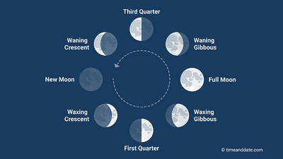

## The Phases of the Moon

* The Moon moves around the Earth in about 28 days.
* Phases of the moon: different shapes of the moon as the moon moves around the Earth, it also spins on its axis. Only the side of the Moon’s surface that is facing the Sun reflects light.

