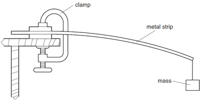
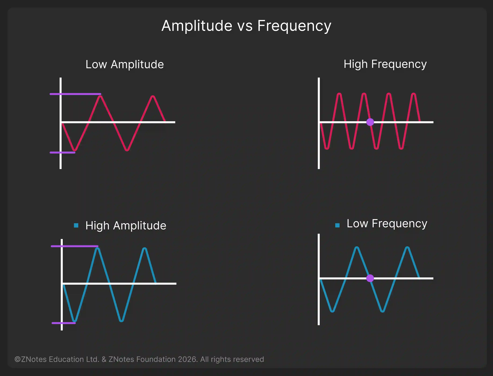
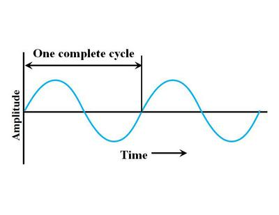

## Properties of The Sound

### Amplitude

* A meter rule is clamped to the bench, and the weight is taped to the free end. When you pull the end downward, the weight vibrates up and down.
* It shows the amplitude of the vibration. **Amplitude is the maximum distance when the vibrating object moves from its resting position before it started vibrating**.

### Frequency

* Frequency is the number of vibrations per second.
* If an object vibrates 20 times each second, its frequency is 20 Hz
* Hz (hertz) is the unit of frequency.
  * 1 Hertz= 1 vibration per second.
* For example: The time for 20 oscillation is 25 seconds.
  * Using the equation: f=n (number of oscillation) / time (seconds)
  * f= 20/25
  * f=0.80 Hz.

### A Complete Vibration

* When the object moves up from its rest position, then down, and then back to its rest position.

