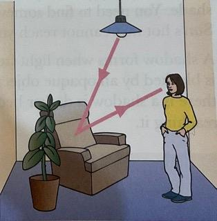

# Light

## Light Source

* A light source is an object that emits its own light.
  * Hot objects such as flames, the Sun, and torch bulbs, are light sources.
  * Some light sources are not hot, such as computer screen

### Straight Lines

* When you see the straight rays of light spreading out from the sun, that tells us that light travels in straight lines.

### Luminous and Non-Luminous

* **An object which is a source of light** is described as **luminous**
  * Examples: Sun, Moon, Stars
* **An object which is not a source of light** is described as **non-luminous**
  * Examples: pen, book,chair, table

* The chair is non-luminous,  you need a source of light to see it