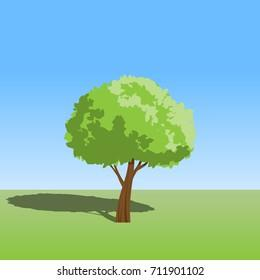
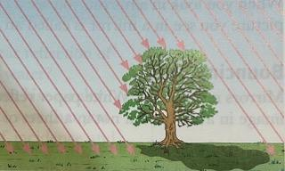

## Formation of Shadows 

* When light strikes an object, different things can happen. It depends on the material the object is made of:
  * The light may pass straight through the object. It has been **transmitted**.
  * The light mat be absorbed by the object (the object gets a little warmer). The material is **opaque**.
  * The light may bounce off the object. It has been **reflected.**

### Forming A Shadow

* A shadow forms when an opaque object blocks the light. it forms because light travels in straight lines-it cannot bend round corners.

  

### Rays of Light

* To understand where the tree’s shadow will fall, you need to draw the ray’s light that comes from the sun.

* By understanding the picture above, you can see which rays are blocked by the tree. This will show you where the tree’s shadow will be.