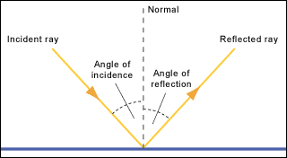

## Reflection

* The picture you see in a mirror is called an image.

* A mirror has a flat, and smooth surface. Rays of light bounce off a mirror without being scattered.

  

* Meanwhile a sheet of paper has a rough surface, when rays of light strike the paper, they are scattered in all directions.

### Predicting The Path Of Light

* **The law of reflection** tell us about the direction in which the ray is reflected.

* How to read the diagram?
  * The mirror is represented by a straight line; the shading shows the back of the mirror
  * The ray of light coming in is called the incident ray.
  * The ray of light going out is the reflected ray.
  * To predict the direction of reflected ray, you need to draw the normal to the normal surface of the mirror.
  * The normal is a straight line drawn at right angles (90 degree) to the mirror.
* The law of reflection of light says the two angles marked in the diagram are equal:
  * Law of reflection: angle of incidence=angle of reflection