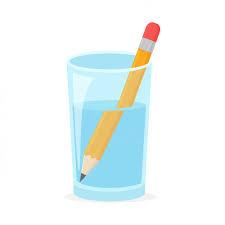

## Refraction

* Water and glass are transparent materials. Light can pass through them, but something happens when light enters or leaves such a material.

* The change of direction of a light ray when it enters or leaves a transparent materials is called **refraction**.

### Rays Changing Direction

* The ray travels in a straight line to the surface of water. This is where it bends. The straight ray then travels to the eye.
  * To understand  how it bends, you draw the normal to the surface at the point where the ray bends. The normal is drawn at 90 degree to the surface.