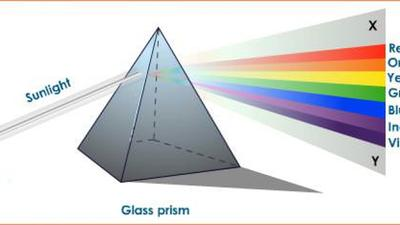
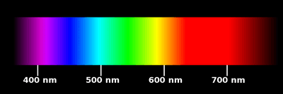

## Dispersion of White Light

* You can see the colors of the rainbow for yourself by sending a ray of white light into a glass prism (triangular glass block)
  * When a light enters the prism it bends (refracted). It also bends as it leaves the prism.
  * Something else happens. The white light is split up into a spectrum of colors. The **splitting up of white light into separate color** is called **dispersion.**
  * The color of spectrum always appear in the same order: red, orange, yellow, green, blue, indigo, violet.

### Explaining Dispersion

* Dispersion happens because of **refraction.**
  * When white light enters a block of glass, some color bend more than others.
  * Violet bends the most, red the last.
  * This means that the different colors travel off in different directions, so that we can see them separately.