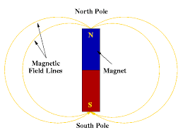

# Magnets

## Magnets, Magnetic Materials and Properties of a Magnets

### Permanent Magnets

* Permanent magnet is an object which stays magnetized for a long time. It doesn’t stop being a magnet after it has been used.

### Magnetic Material

* A material which is attracted by a magnet is called a magnetic material.
  * Some materials are attracted, other materials are not.
* Example of magnetic material:
  * Iron
  * Steel (most of the steels are made from iron)
  * Nickel
  * Cobalt
  * Neodymium

### Magnetic Poles

* Magnets that attract magnetic materials will create **magnetic force.**
* A bar magnet’s magnetism is strongest at the ends. The ends of the magnet are called magnetic poles.

* If two magnets are close together, they may attract each other or they may push each other away.

### Magnet Rules

* Like poles will repel, means both poles are the same (north pole and north pole) will repel.
* Unlike poles will attract, means one north pole and one south pole will attract each other.