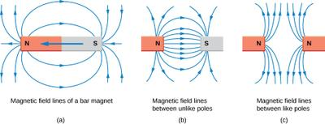

## Magnetic Field Patterns

### Magnetic Field

* Any magnetic material placed in the field will be attracted by the magnet, due to magnets is  surrounded by a **magnetic field.**

### The Shape of The Field

* A magnetic field is invisible. There are some ways to show up:
  * Using iron fillings, these tiny pieces of iron will get together and line up to show the pattern of the field.
  * Using small compasses, this called plotting compasses. They will show the direction of the field.

### Magnetic Field Lines

* We can represent the magnetic field of a magnet by drawing magnetic field lines (imaginary).
* Magnetic field lines start from a north pole and end up at a south pole. They show two things about the field:
  * The arrows show the direction of the field.

  * The lines are closest together, the field is strongest.

    