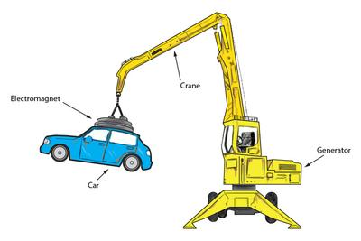
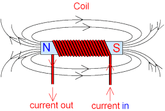

## Electromagnet

### Electromagnet and its Uses 

* There is a second type of magnet called an electromagnet, it works using electricity and it can be switched on and off.

* Example: Using electromagnet to lift a scrap car, electric motors and generators, doorbell and in electric switches

  

### How To Make An Electromagnet?

* Wrap the wire around a piece of iron called a core.
  * When a current flows in the coil, the iron becomes magnetized and this makes the magnetic field of the electromagnet much stronger.
* Making a stronger electromagnet:
  * Make a coil with more turns of wire, the wire is longer and so the electric current flows through it. It makes a stronger magnetic field.
  * Make a bigger electric current flow in the coil of wire, connect 2 batteries to the coil instead of one. This will make a bigger electric current flow so the magnetic field will be stronger.

### The Field Of An Electromagnet

* Whenever an electric current flows in a wire it makes a magnetic field around it.

* The magnetic field of an electromagnet is like the field of a bar magnet

  * The magnetic field lines come out of one end of the electromagnet. This is its north pole.

  * The fields line go round and  back into the other end of electromagnet. This is its south pole.

    

### How An Electromagnet Works?

* The magnetic field around a wire is quite weak, by winding the wire into a coil, it will concentrate the magnetic field into a smaller space making it much stronger.