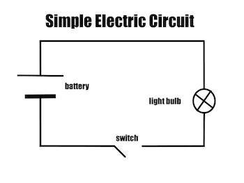
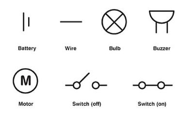

## Types of Components

### Describing Conductors and Insulators

* Metals are described as conductors because they allow electricity to pass through them
* Plastic and other non-metals are described as insulators because they do not allow electricity to pass through them.

### Electric Current

* The lamp is light up because there is an electric current in the circuit.
* Two things are needed for there to be an electric current:
  * A complete circuit of metal around which the current can flow.
  * A cell (a battery) makes the current flow.
* A switch breaks a circuit to stop the current from flowing.

### Circuit Symbols

* Circuit Diagram:

  

* Circuit symbol:

  