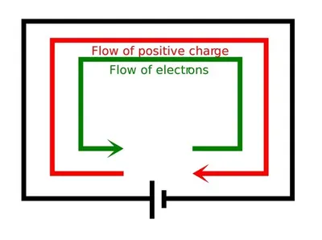

## Understanding Electric Current

### Explaining About Current Flow

* Metals are useful materials because they contain lots of electrons that can move about inside the metal.
  * These electrons are not tightly attached to their atoms.
* A cell can make a current flow in a metal wire. Since the electrons move along in metal wire, the electrons have an electric charge, so the charge is moving through the metal.

### How A Cell Makes A Current Flow

* In the cell, one end is positive and one end is negative. The positive end attracts electrons (because electrons have a negative charge).
  * So, when a circuit is complete, the electrons in the metal of the circuit start moving around it. They are pushed from the negative end of the cell and attracted toward the positive end.

### Lighting A Lamp - Current and Energy

* When you push a switch, a current starts immediately. The electrons are waiting in the wire. They start to move all around the circuit as soon as the switch is closed.
  * The cell is the energy source of the circuit. It is a store of chemical energy.
  * The current transfers energy from the cell to the lamp.
  * The lamp gets hot and shines. It is a source of light energy and heat energy.