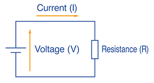

## Resistance 

### What Happens If We Add Other Components To A Series Circuit?

* We can understand why the current is smaller when there are two lamps in the series circuit.
  * The electrons are being pushed by the cell. It has to push them through one lamp and then through the next.
  * It is easier for the cell to push the electrons through one lamp than through two, and so the current is bigger when there is only one lamp in the circuit.

### Electrical Resistance

* We can say that a lamp has resistance. The more resistance there is in the circuit, the harder it is for the cells to push the electrons around, and so the current is smaller.

* The unit of resistance is Ω (ohm).

  \
  

### Losing Energy

* When 2 components are connected in series in a circuit, it is harder for the current to flow. There is more resistance, so the current is smaller.
  * It requires energy for the electrons to flow through any component which has resistance