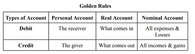

# Basic’s Concepts

## Accounts

**Accounts are of three types:**

1. **Personal Account**: which includes

   a) Natural Person’s Account: relating to individual human beings. Example: Zeenal’s Account, Laher’s Account, Suresh’s Account, Ranjan’s Account, Ronak’s Account, Mayank’s Account.

   b) Artificial Person’s Account: This refers to organizations and associations created by law. Examples are HDFC Bank Account, Diamond Enterprise Account, and Recreation Club Account.

   c) Representative Personal Account: This account deals with outstanding and prepaid items. Examples: Outstanding Rent Account, Pre-received Rent Account.
2. **Real Account**: includes assets and properties owned by the business.

   a) Tangible Real Account: assets that can be seen, touched, and felt. Example: Machinery Account, Furniture Account.

   b) Intangible Real Account: assets that cannot be seen, touched, or felt but can be measured in terms of money. Example: Goodwill Account.
3. **Nominal Account**: includes all expenses, losses, income, and gains. Example: Rent Account, Wages Account, Interest received Account.

 