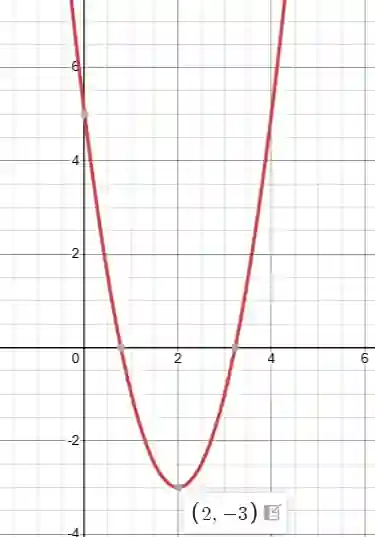

## Solving Quadratics

### **Completing The Square:**

Rewrite $f(x)$ in vertex form.

Example:

Given
$
f(x) = 2x^2 - 8x + 5
$

Start by factoring out the coefficient of $x^2$ from the first two terms:

$
2(x^2 - 4x) + 5
$

Take half of the coefficient of $x$ inside the parentheses, (-4), divide by 2 and square it:

$
\left(\frac{-4}{2}\right)^2 = (-2)^2 = 4
$

Add and subtract this inside the parentheses to complete the square:

$
2 \big( x^2 - 4x + 4 - 4 \big) + 5
$

Rewrite as a perfect square trinomial:

$
2 \big( (x - 2)^2 - 4 \big) + 5
$

Expand:

$
2(x - 2)^2 - 8 + 5
$

Simplify:
$
2(x - 2)^2 - 3
$

The minimum value occurs at
$
x = 2, \quad f(2) = -3
$

### **Factorising**:

Solve $$x^2 - 6x + 9 = 0$$ by factorising.

Multiply the coefficient of $x^2$ and the constant term:

$
1 \times 9 = 9
$

Find two numbers that multiply to 9 and add to -6:

$
-3 \text{ and } -3
$

iv. Rewrite the middle term using -3 and -3:

$
x^2 - 6x + 9 = 0
$

v. Split the middle term:

$
x^2 - 3x - 3x + 9 = 0
$

Group terms:

$
x(x - 3) - 3(x - 3) = 0
$

vi. Factorise completely:

$
(x - 3)(x - 3) = 0 \quad \Rightarrow \quad x = 3, ; x = 3
$

### **Quadratic Formula:**

Standard Form: $ax^2+bx+c=0$

Compare With: $x^2−6x+9=0$ ⇒ $a=1,b=−6 ,c=9$

Input into the quadratic formula: $x = \frac{-b \pm \sqrt{b^2 - 4ac}}{2a}$

$x = \frac{-(-6) \pm \sqrt{(-6)^2 - 4 \cdot 1 \cdot 9}}{2 \cdot 1}$

$x = \frac{6 \pm \sqrt{36 - 36}}{2}$

$x = \frac{6 \pm 0}{2} = 3$