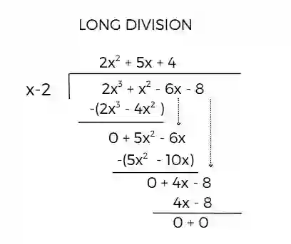
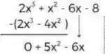
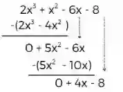
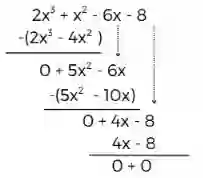

## Long Division

e.g. using long division and synthetic division to divide

$2x^3+x^2-6x-8$ by $x-2$

**Step 1: Set Up**

$$
\frac{2x^3 + x^2 - 6x - 8}{x - 2}
$$

**Step 2: Divide Leading Terms**

Take the first term of the dividend: $ 2x^3 $

Divide by the first term of the divisor: $\frac{2x^3}{x} = 2x^2$

Write $ 2x^2 $ above the division bar.

**Step 3: Multiply**

$
2x^2 \cdot (x - 2) = 2x^3 - 4x^2
$

Write it under the dividend and subtract:

**Step 4: Divide Again**

$
\frac{5x^2}{x} = 5x
$

**Step 5: Multiply**

$
5x \cdot (x - 2) = 5x^2 - 10x
$

Subtract:

$
(5x^2 - 6x) - (5x^2 - 10x) = 4x
$

Bring down the next term:

New expression: $4x - 8$

**Step 6: Final Step**

Divide:

$
\frac{4x}{x} = 4
$

Multiply:

$
4 \cdot (x - 2) = 4x - 8
$

Subtract:

$
(4x - 8) - (4x - 8) = 0
$

Final Answer:

$
2x^2 + 5x + 4
$