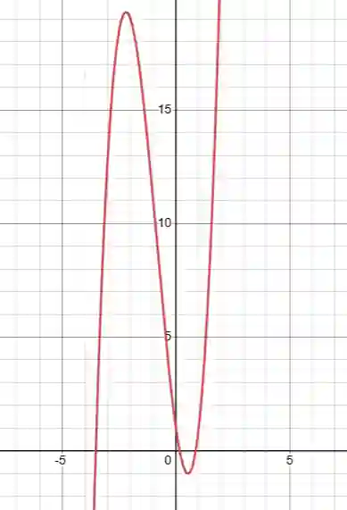

## Sketching Cubic Graphs

Given a cubic function, for example:

$$
f(x) = 2x^3 + 5x^2 - 7x + 1
$$

* $x$-intercepts (roots):\
  The x-intercepts occur where the function equals zero.\
  If the function is factored as
  $$
  f(x) = (x - a)(x - b)(x - c)
  $$
  then the roots are $x = a, b, c$.

* y-intercept:
  Set $x = 0$ in the function:$$f(0) = 2 \cdot 0^3 + 5 \cdot 0^2 - 7 \cdot 0 + 1 = 1$$\
  So the graph crosses the y-axis at $(0,1)$.

* End behavior of the cubic graph:

  The degree of the polynomial is 3 (odd degree).

  The leading coefficient is +2 (positive).

  For odd degree polynomials:

  * If the leading coefficient is positive, the graph falls to the bottom left and rises to the top right.

  * If the leading coefficient is negative, the graph rises to the bottom left and falls to the top right.

Since the leading coefficient here is +2, the graph behaves like this:

General rules:

For odd degree polynomials:

- If the leading coefficient is positive, the graph falls to the bottom left and rises to the top right

- If the leading coefficient is negative, the graph rises to the bottom left and falls to the top right

End behavior of even degree polynomials:

- If the leading coefficient is positive, both ends go up

- If the leading coefficient is negative, both ends go down