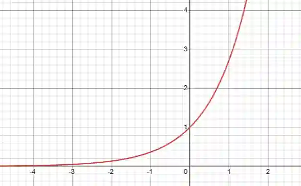

## Exponential Functions

$f(x)=e^x$

**Domain** $x \in \mathbb{R} \quad (\text{i.e., } -\infty < x < \infty)$

**Range** $y>0 \quad (\text{i.e., } 0<y<\infty)$

**Key Point**: Passes through $(0,1)$

**Asymptote**: Horizontal at $y=0$

**Behavior**: Increases rapidly as $x$ increases

