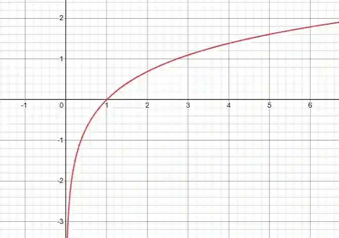

## Logarithmic Functions

**$g(x)=\ln x$**

**Domain** $x>0 \quad (\text{i.e., } 0<x<\infty)$

**Range**: $y \in \mathbb{R} \quad (\text{i.e., } -\infty < y < \infty)$

**Key Point:** Passes through $(1,0)$

**Asymptote**: Vertical at $x=0$

**Behavior**: Increases slowly as $x$ increases

$f(x)=e^x$ and $g(x)=\ln x$ are are inverses of each other

