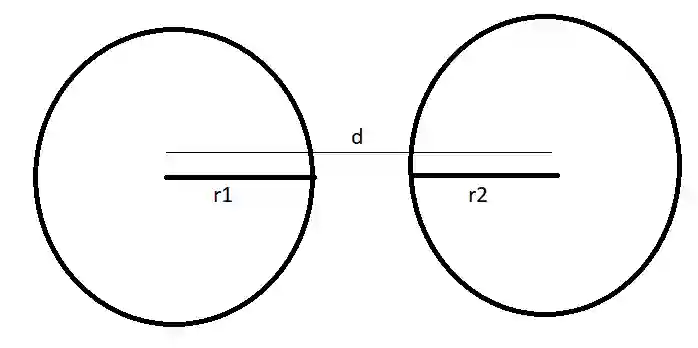
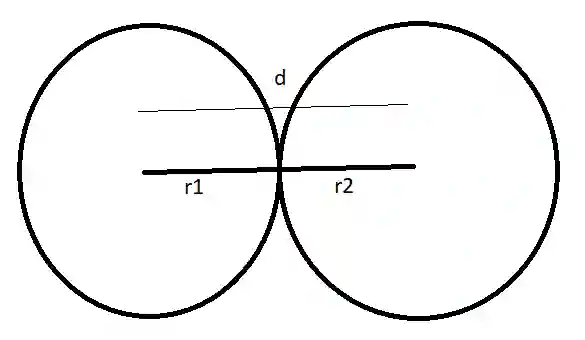
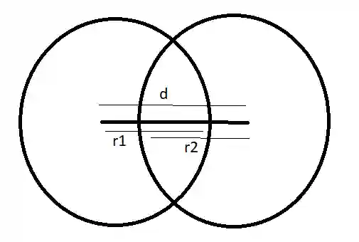

## Intersection of Two Circles

First circle:

$$
(x - a_1)^2 + (y - b_1)^2 = r_1^2
$$

Second circle:

$$
(x - a_2)^2 + (y - b_2)^2 = r_2^2
$$

Subtract to eliminate squared terms and solve the linear system.

Let d be the distance between centres:

$$
d = \sqrt{(a_1 - a_2)^2 + (b_1 - b_2)^2}
$$

Then:

$$
d > r_1 + r_2 \Rightarrow \text{No intersection}
$$

$$
d = r_1 + r_2 \Rightarrow \text{Touch externally}
$$

$$
d < \|r_1 + r_2\| \Rightarrow \text{Overlapping circles}
$$

