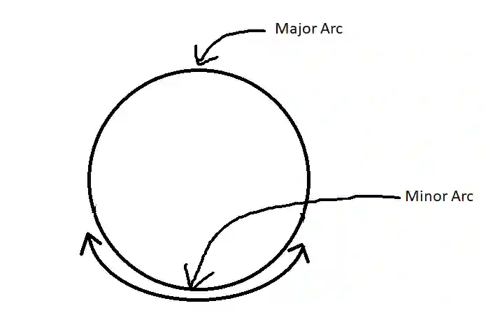
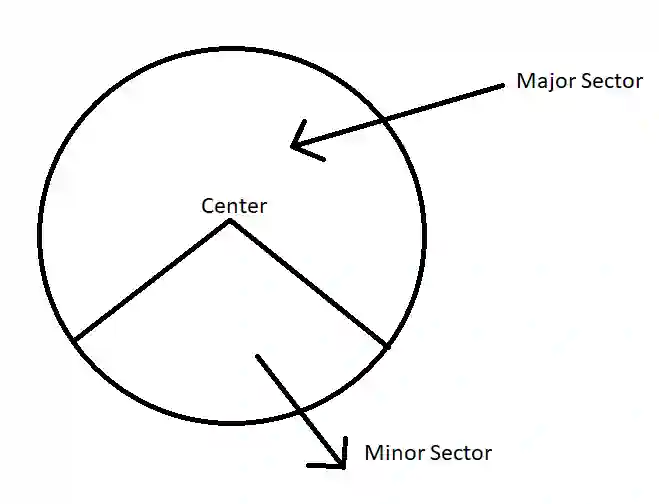
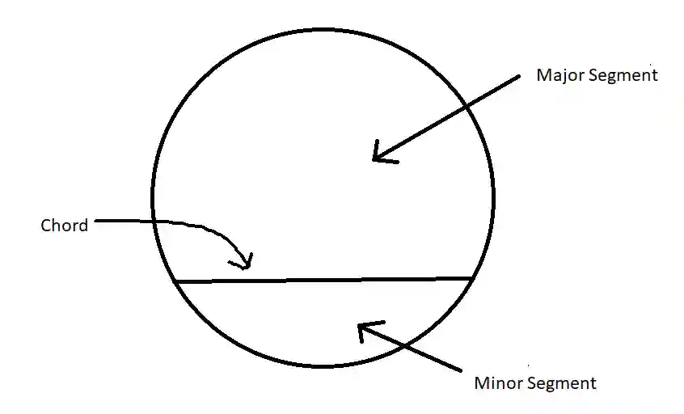
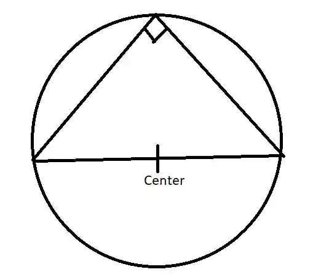
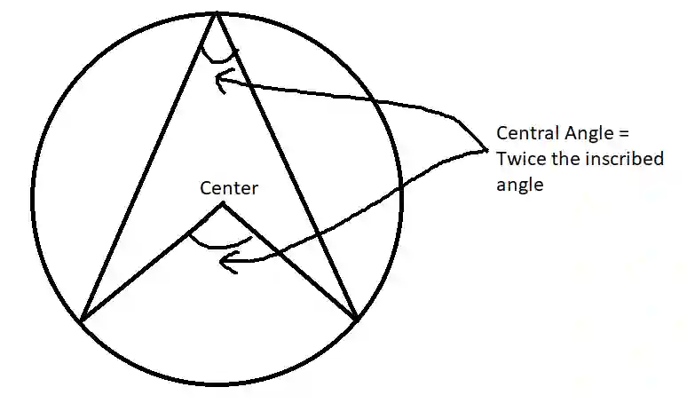
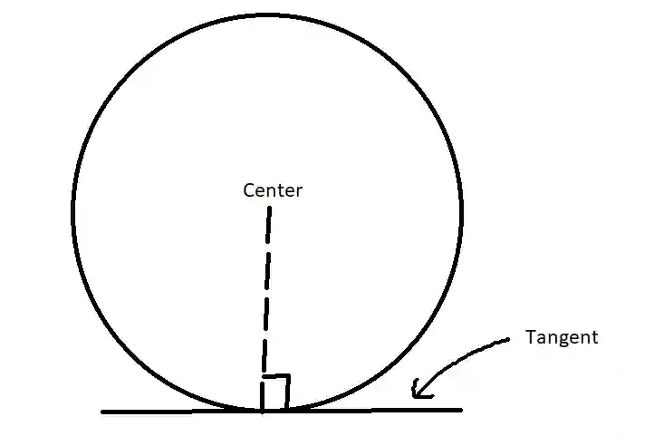
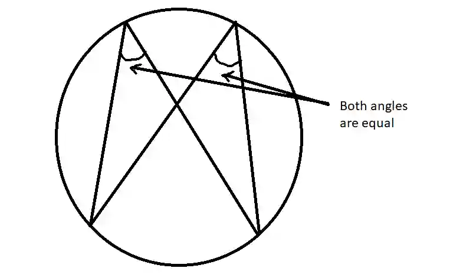
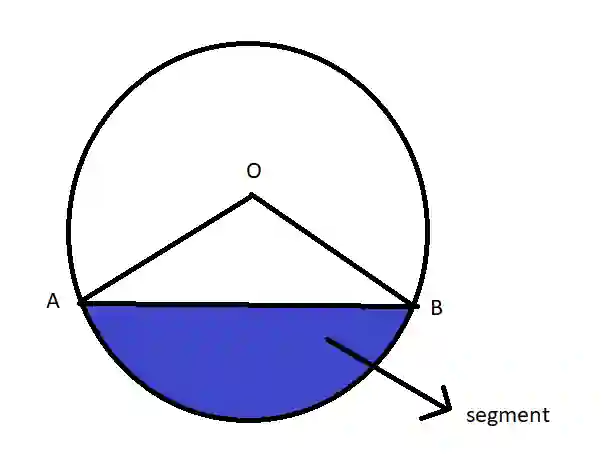
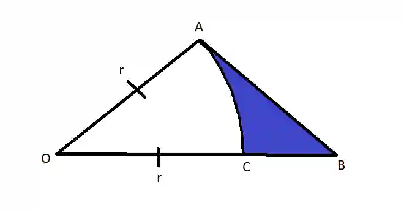
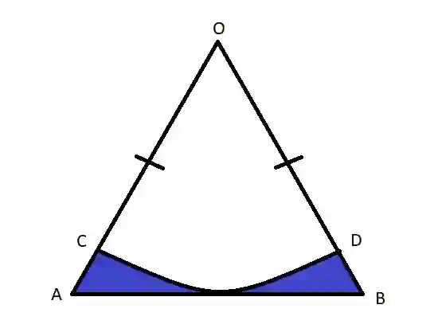

## Geometrical Properties Of Circles

### Arcs of a Circle

* Minor Arc: The shorter arc created by two points.

* Major Arc: The longer arc created by two points.

### Sectors of a Circle

* Minor sector: The smaller region between two radii and the arc of a circle.

* Major sector: The larger region between two radii and the arc of a circle.

* Minor segment: The smaller area between a chord and the arc of a circle.

* Major segment: The larger area between a chord and the arc of a circle

* The angle in semi-circle is always $90\degree$

* An angle formed by an arc at the center is twice the inscribed angle formed by the same arc.

* Radius is always perpendicular to the tangent at the point where it touches the circle.

* Angles formed by the same arc on the circumference of the circle is always equal.

* Area Of Segment = Area of Sector $AOB$ - Area of $\Delta AOB$

* Perimeter Of Segment = $AB$ + Arc $AB$

* Area Of Shaded Region = Area of $\Delta AOB$ - Area of Sector AOC

* Perimeter Of Shaded Region = $AB$ + Arc $AC$ + $(OB - OC_r)$

* Area of Shaded Region = Area of $\Delta AOB$ - Area of Sector $COD$

* Perimeter of Shaded Region = Arc $CD$ + $2(OA_r - AC)$ + $AB$

