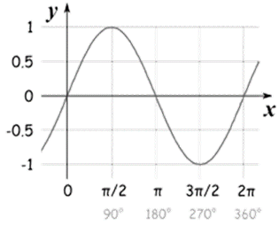
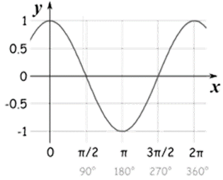
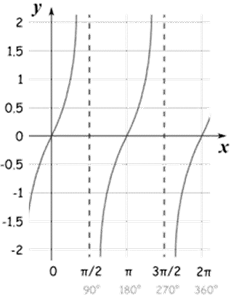
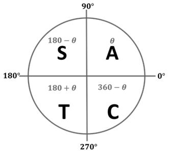

# Trigonometry

## Introduction

Easy mnemonic to remember: **SOH CAH TOA**

"Some Old Horses" → $\sin(\theta) = \frac{\text{Opposite}}{\text{Hypotenuse}}$

\
"Can Always Hear" → $\cos(\theta) = \frac{\text{Adjacent}}{\text{Hypotenuse}}$

\
"Their Owner Approach" → $\tan(\theta) = \frac{\text{Opposite}}{\text{Adjacent}}$

|**SINE CURVE**|**COSINE CURVE**|
|:---|:---|
|||

|**TANGENT CURVE**|**CAST DIAGRAM**|
|:---|:---|
|||

Understand and use the CAST diagram - it helps determine the sign of trig functions in different quadrants.

**Remember:**

C (Cos) is positive in Quadrant IV

A (All) are positive in Quadrant I

S (Sin) is positive in Quadrant II

T (Tan) is positive in Quadrant III

The letters go **clockwise starting from Quadrant IV**

---

**Example 1:** Solve $\sin x = \frac{1}{2}$ for $0^\circ \leq x < 360^\circ$

We know:

$$
\sin x = \frac{1}{2} \implies x = 30^\circ \quad \text (base angle)
$$

Since $\sin x = \frac{1}{2}$ is positive, $x$ lies in quadrants where sine is positive, i.e., Quadrant I and Quadrant II.

In Quadrant 1 (A), $x = 30^\circ$ because $\sin 30^\circ = \frac{1}{2}$.

In Quadrant 2 (S), the reference angle is $30^\circ$, so
$$
x = 180^\circ - 30^\circ = 150^\circ.
$$

Thus, solutions in $0^\circ \leq x < 360^\circ$ are:
$$
x = 30^\circ, \quad 150^\circ.
$$

**Example 2:** Solve $\cos(2x) = 0$ for $ 0 \leq x \leq 360^\circ $.

If the angle is not just x, for example in the equation
$$
\cos(2x) = 0,
$$
first solve for 2x. Then, divide the solutions by 2 to find the values of x.

$$
\cos(2x) = 0 \implies 2x = 90^\circ, 270^\circ
$$

Dividing both sides by 2,

$$
x = 45^\circ, 135^\circ.
$$