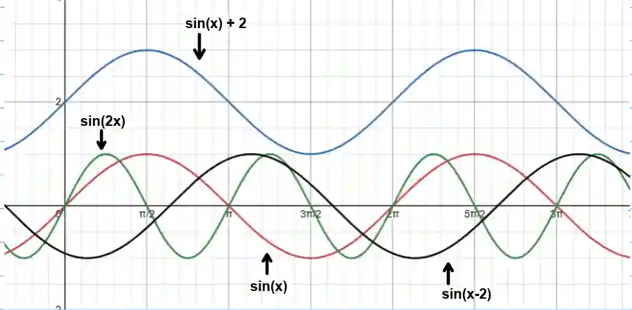

## Graph Transformations

The general form of a transformed function is:

$$
f(x) = A \sin\left(B(x - C)\right) + D
$$

Where:

A = Amplitude (vertical stretch or compression)

$\dfrac{2\pi}{B}$  = New period (horizontal stretch or compression)

C  = Phase shift (horizontal translation)

D = Vertical shift (also known as the sinusoidal axis or midline)

$$
\text{Period of } \sin x = 2\pi
$$

$$
\text{Period of } \cos x = 2\pi
$$

$$
\text{Period of } \tan x = \pi
$$

**Example:**

