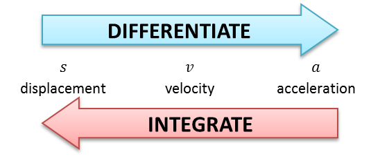

## Kinematics

**Key Ideas**

- Particle at instantaneous rest:

$$
v = 0
$$

- Maximum displacement from origin:

$$
v = 0
$$

- Maximum velocity:

$$
a = 0
$$

---

**Displacement–Time Graph**

- Y-axis: Displacement $ s $

- X-axis: Time $ t $

- Gradient:$\text{velocity} = \frac{\Delta s}{\Delta t}$

- A curved line indicates changing velocity ⇒ acceleration

- A horizontal line means displacement is constant (object is at rest)

**Example:**\
If displacement increases from 0 to 10 m in 5 s:
$$
\text{velocity} = \frac{10 - 0}{5 - 0} = 2\text{m/s}
$$

---

**Distance–Time Graph**

- Y-axis: Distance travelled (always increasing or constant)

- X-axis: Time $ t $

- Direction is ignored, only magnitude matters

- Gradient:$\text{speed} = \frac{\text{distance}}{\text{time}}$

- Steeper line ⇒ higher speed

- A horizontal line means stationary (no distance added)

**Example:**\
Distance increases from 0 to 100 m in 20 s:
$$
\text{speed} = \frac{100}{20} = 5\text{m/s}
$$

---

**Velocity–Time Graph**

- Y-axis: Velocity (can be negative if direction reverses)

- X-axis: Time $ t $

- Gradient:$\text{acceleration} = \frac{\Delta v}{\Delta t}$

- Area under graph = displacement

- Horizontal line = constant velocity

- Negative velocity ⇒ motion in opposite direction

**Example:**\
Constant velocity of 4 m/s for 6 s:
$$
\text{displacement} = 4 \times 6 = 24\text{m}
$$

---

**Speed–Time Graph**

- Y-axis: Speed $ = \|v\| $ (always non-negative)

- X-axis: Time $ t $

- Area under graph = total distance travelled

- Used when object changes direction but we care only about total distance

**Example:**\
Speed = 3 m/s for 10 s:
$$
\text{distance} = 3 \times 10 = 30\text{m}
$$

---

**Acceleration–Time Graph**

- Y-axis: Acceleration $ a $

- X-axis: Time $ t $

- Area under graph = change in velocity:
  $$
  \Delta v = \int a(t)  dx
  $$

- Horizontal line = constant acceleration

- If acceleration is negative, object is decelerating

**Example:**\
Acceleration = 2 m/s² for 5 s:
$$
\Delta v = 2 \times 5 = 10\text{m/s}
$$