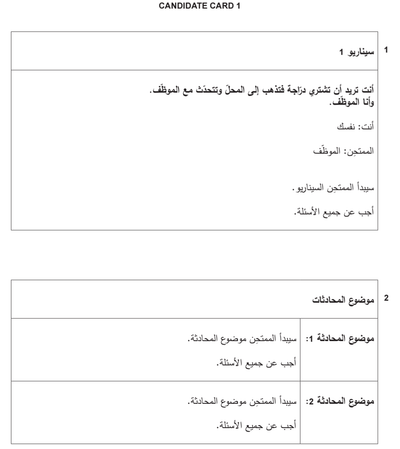
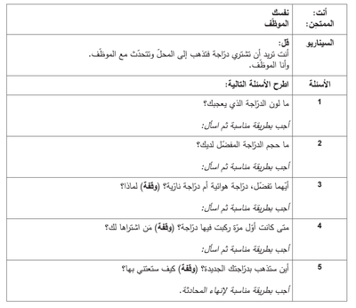

## Example 1

### Candidate Card 1:

### Questions:

### Answer Examples:

1. لون دراجتي المفضل هو اللون الـ(أخضر/أصفر/أحمر…)، فأنا أحب هذا اللون كثيرا

2. أنا أحب الحجم الكبير، لأن الدراجات الكبيرة سريعة جدا

3. أنا أفضل الدراجة الهوائية لانها رخيصة وصديقة للبيئة، ولا تصدر ضجيجا

4. كان عمري ٦ سنوات عندما أشترى لي والدي دراجة هوائية زرقاء

5. أود أن أذهب بها الى السوق أو الشاطئ، ﻷن المشي الى هناك صعب. سأحافظ عليها وأنظفها كل أسبوع، وسأضعها في مكان أمن، وسأقودها بأمان