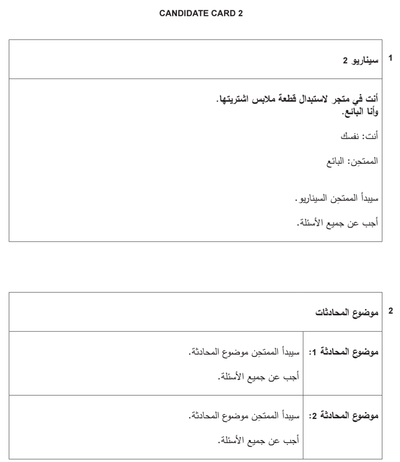
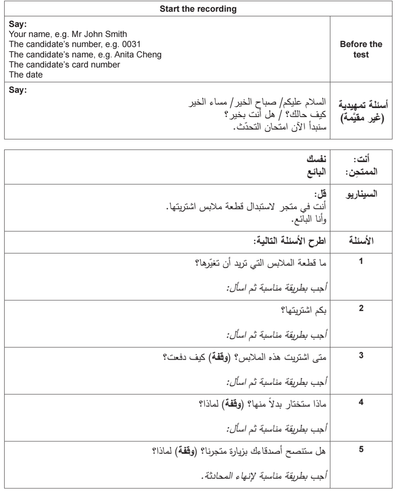

# Example 2

### Candidate Card 2:

### Questions:

### Answer Examples:

1. أريد أن أغير هذا الجاكيت البني من فضلك

2. أشتريت هذا الجاكيت بمئة دينار

3. أشتريته قبل يومين، ودفعت باستخدام البطاقة

4. سأختار هذا الجاكيت الاسود ﻷنني أفضل هذا اللون، وهذا الجاكيت البني صغير جدا

5. نعم بالتأكيد، سأنصح أصدقائي بزيارة هذا المحل، الملابس هنا جيدة جدا وقيمتها عالية